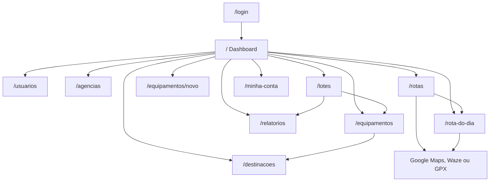
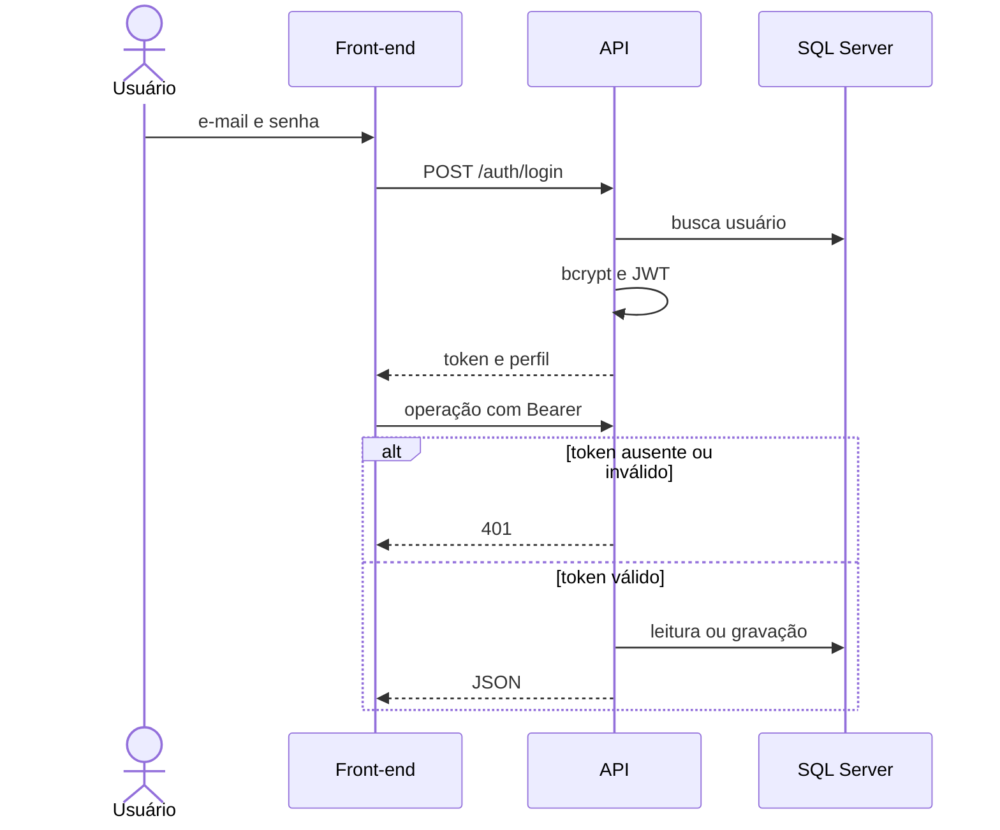
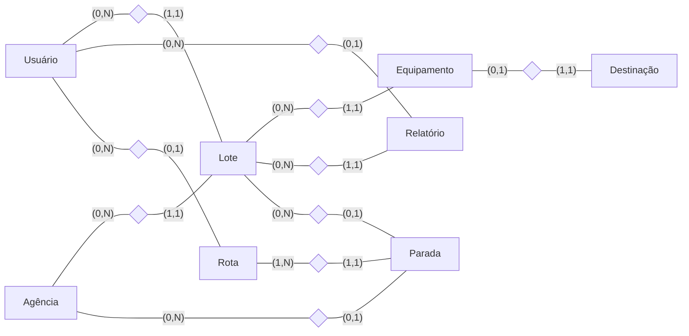

# Arquitetura

## Contexto técnico

Produto web para a operação da Wert. Uso em navegador, na base da empresa, em desktop ou tablet. Desenvolvimento local com containers e, a partir da Sprint 10, sistema publicado com HTTPS. Sem aplicativo de campo e sem rastreamento do veículo em tempo real: a rota usa a localização cadastrada dos pontos de coleta e de entrega, e a navegação até as paradas abre no Google Maps, no Waze ou em arquivo GPX.

A navegação, as camadas e o modelo de dados abaixo são as características gerais do produto. O [Artefato 3](../entregas/artefato_3/README.md) continua sendo a entrega acadêmica (testes de integração, wireframes e storyboard). Este arquivo deixa o mesmo desenho legível no repositório.

## Objetivos da informação

| Objetivo | O que o sistema precisa mostrar |
| --- | --- |
| Centralizar a operação | Usuários, agências, lotes, equipamentos e destinações no mesmo lugar |
| Rastreabilidade e conformidade | Caminho agência, lote, equipamento e destinação, com PDF e dashboard |
| Planejamento das coletas | Rota com origem, destino e paradas localizadas, motorista atribuído, status de recolhimento e exportação para navegação |

## Componentes

O código da aplicação fica em `src/`:

```text
src/
├── backend/     API REST, regras de negócio, geração de PDF
└── frontend/    Interface web
```

| Camada | Tecnologia | Responsabilidade |
| --- | --- | --- |
| Front-end | React, JavaScript, CSS | Telas desktop, sessão e consumo da API |
| Back-end | Node.js, Express | Regras de negócio, autenticação, autorização e PDF |
| Persistência | SQL Server | Entidades e datas de criação e atualização |
| Ambiente | Docker Compose | Banco, API e interface sobem juntos |
| Publicação | Docker Compose de produção, Caddy | HTTPS, segredos fora do repositório, banco e PDFs em volumes |

Fluxo geral: usuário, interface web, API, banco de dados. O front chama a API pela URL configurável `VITE_API_URL`. No sistema publicado, a interface e a API ficam no mesmo endereço, e a API responde em `/api`.

```text
[Navegador desktop]
        |
        v
[src/frontend] --JSON + Bearer JWT--> [src/backend] --SQL--> [SQL Server]
                                            |
                                            v
                                       [PDFs gravados]
```

## Navegação

Canal: navegador, em desktop ou tablet. Não há aplicativo nativo. A rota tem a localização dos pontos e é aberta nos aplicativos de navegação (Google Maps, Waze ou GPX); não há rastreamento do veículo em tempo real.



O menu lateral é o índice permanente. Cada perfil vê só as telas que pode abrir, e a API recusa a operação que o perfil não pode fazer. Tela fora do perfil, digitada na barra de endereço, volta para o Dashboard.

| Item | Rota | Admin | Gestor | Técnico | Auditor | Motorista |
| --- | --- | --- | --- | --- | --- | --- |
| Dashboard | `/` | sim | sim | sim | sim | sim |
| Agências | `/agencias` | sim | sim | não | não | não |
| Usuários | `/usuarios` | sim | não | não | não | não |
| Lotes | `/lotes` | sim | sim | sim | consulta | não |
| Equipamentos | `/equipamentos/novo` | sim | sim | sim | não | não |
| Listagem | `/equipamentos` | sim | sim | sim | consulta | não |
| Destinação | `/destinacoes` | sim | sim | sim | consulta | não |
| Relatórios | `/relatorios` | sim | sim | não | sim | não |
| Rotas | `/rotas` | sim | sim | não | não | não |
| Rota do dia | `/rota-do-dia` | não | não | não | não | sim |
| Minha conta | `/minha-conta` | sim | sim | sim | sim | sim |

Mudanças de navegação da Sprint 10:

- **Minha conta** (`/minha-conta`), para todos os perfis: troca da própria senha (RF26).
- **Rotas** e **Rota do dia**: origem, destino e ordem sugerida das paradas (RF29) e exportação para Google Maps, Waze e GPX (RF30, RF31).
- Cadastro dos pontos de entrega e da localização das agências, para administrador e gestor (RF27, RF28).
- O motorista entra direto na Rota do dia depois do login (RNF17).

O auditor consulta lotes, equipamentos e destinações e gera e baixa relatórios. Não cria lote, equipamento nem destinação. O motorista vê a rota atribuída a ele, registra o recolhimento e abre a navegação até as paradas.

| Persona | Papel | Caminho principal |
| --- | --- | --- |
| Renata | Administradora | Login, usuários, perfis |
| Marcos | Gestor | Dashboard, agências, lotes, rotas e recolhimento |
| Camila | Técnica de triagem | Lotes, equipamentos, destinação, conclusão do lote |
| Helena | Auditora | Consulta operacional e relatórios |
| Paulo | Motorista | Rota do dia, navegação até as paradas e status de recolhimento |

| Na tela | Significa |
| --- | --- |
| Agência | Ponto de coleta: código, cidade, UF, endereço e coordenadas |
| Ponto de entrega | Depósito ou destinadora: endereço e coordenadas |
| Lote | Coleta ligada a uma agência: `pendente`, `em_triagem` ou `concluido` |
| Equipamento | Item do lote: tipo, marca, modelo, série e estado |
| Destinação | Reciclagem, reúso ou destruição, com empresa, data e certificado opcional |
| Rota | Data, motorista, origem, destino e paradas ordenadas |
| Recolhimento | `recolhido`, `nao_recolhido` ou `parcial` |

## API

Todas as rotas de produto, exceto `POST /auth/login` e `GET /health`, exigem `Authorization: Bearer`.

| Grupo | Rotas |
| --- | --- |
| Saúde | `GET /health` |
| Autenticação | `POST /auth/login` e `PUT /auth/senha` (troca da própria senha) |
| Agências | `GET`, `POST`, `PUT` e `DELETE /agencias` |
| Usuários | CRUD `/usuarios` |
| Lotes | CRUD `/lotes` e `PATCH /lotes/:id/status` |
| Equipamentos | `GET`, `POST` e `PUT /equipamentos` |
| Destinação | CRUD `/destinacoes` |
| Relatórios | `POST /relatorios/gerar`, `GET /relatorios` e `GET /relatorios/:id/arquivo` (download do PDF) |
| Dashboard | `GET /dashboard` |
| Rotas e recolhimento | Cadastro da rota, atribuição do motorista e status da parada |

Senha com bcrypt. Sessão com JWT. PDF com PDFKit. A partir da Sprint 10, o PDF é baixado só por `GET /relatorios/:id/arquivo`, com login e perfil administrador, gestor ou auditor, e a pasta de arquivos não é pública. A chave do token, a senha do banco, a senha inicial do administrador e a origem permitida da API vêm de variáveis de ambiente. O login tem limite de tentativas, e as respostas de erro não trazem detalhe interno.



## Dados

> **ATUALIZAR COM O SCHEMA DA MAIN NO DIA.** Este modelo segue o `src/backend/src/config/schema.js` da `main` da Sprint 09. Antes do commit, conferir o `schema.js` da `main` do dia (campos de localização da agência, ponto de entrega, origem e destino da rota) e apagar este aviso.

Modelo entidade-relacionamento na notação de Peter Chen, conforme o `src/backend/src/config/schema.js`.

O diagrama está em Mermaid (`flowchart`), no estilo de Chen. O GitHub desenha o Mermaid direto no Markdown, o texto fica versionado junto com este arquivo e a mudança aparece linha a linha no pull request. Uma imagem SVG exigiria uma ferramenta de desenho para cada ajuste e não mostraria a diferença na revisão.

Como ler:

- retângulo: entidade (uma tabela do banco);
- losango: relacionamento, sem nome;
- rótulo da linha: cardinalidade **(mínimo, máximo)** com que a entidade daquele lado participa do relacionamento. `(0,N)` = nenhuma ou várias vezes; `(1,1)` = exatamente uma vez; `(0,1)` = no máximo uma vez.
- os atributos de cada entidade, com tipo, tamanho e restrições, estão no dicionário de dados logo abaixo, para o diagrama caber na página.



| Relacionamento | Entidades | Cardinalidade | De onde vem |
| --- | --- | --- | --- |
| R1 | Agência – Lote | Agência (0,N); Lote (1,1) | `lote.agencia_id` NOT NULL, FK para `agencia` |
| R2 | Usuário – Lote | Usuário (0,N); Lote (1,1) | `lote.tecnico_id` NOT NULL, FK para `usuario` (o técnico responsável) |
| R3 | Lote – Equipamento | Lote (0,N); Equipamento (1,1) | `equipamento.lote_id` NOT NULL, FK para `lote` |
| R4 | Equipamento – Destinação | Equipamento (0,1); Destinação (1,1) | `destinacao.equipamento_id` NOT NULL e UNIQUE |
| R5 | Lote – Relatório | Lote (0,N); Relatório (1,1) | `relatorio.lote_id` NOT NULL, FK para `lote` |
| R6 | Usuário – Relatório | Usuário (0,N); Relatório (0,1) | `relatorio.gerado_por` NULL, FK para `usuario` (quem gerou) |
| R7 | Usuário – Rota | Usuário (0,N); Rota (0,1) | `rota.motorista_id` NULL, FK para `usuario` (o motorista) |
| R8 | Rota – Parada | Rota (1,N); Parada (1,1) | `parada.rota_id` NOT NULL, FK com `ON DELETE CASCADE`. O mínimo 1 do lado da rota é regra da API: a rota não é salva sem parada |
| R9 | Agência – Parada | Agência (0,N); Parada (0,1) | `parada.agencia_id` NULL, FK para `agencia` |
| R10 | Lote – Parada | Lote (0,N); Parada (0,1) | `parada.lote_id` NULL, FK para `lote`. `CK_parada_alvo` exige agência ou lote em toda parada |

### Dicionário de dados

Tamanho: número máximo de caracteres para texto e espaço ocupado no SQL Server para os tipos de tamanho fixo. Todos os `id` são `INT IDENTITY(1,1)`, começam em 1 e são gerados pelo banco.

#### usuario

| Campo | Tipo | Tamanho | Restrições |
| --- | --- | --- | --- |
| id | INT | 4 bytes | PK, IDENTITY(1,1) |
| nome | NVARCHAR | 150 caracteres | NOT NULL |
| email | NVARCHAR | 150 caracteres | NOT NULL, UNIQUE |
| senha_hash | NVARCHAR | 255 caracteres | NOT NULL (hash bcrypt, nunca a senha) |
| perfil | NVARCHAR | 30 caracteres | NOT NULL, CHECK `CK_usuario_perfil`: administrador, tecnico, gestor, auditor ou motorista |
| ativo | BIT | 1 bit | NOT NULL, DEFAULT 1 |
| criado_em | DATETIME2 | 8 bytes | NOT NULL, DEFAULT SYSDATETIME() |
| atualizado_em | DATETIME2 | 8 bytes | NOT NULL, DEFAULT SYSDATETIME() |

#### agencia

| Campo | Tipo | Tamanho | Restrições |
| --- | --- | --- | --- |
| id | INT | 4 bytes | PK, IDENTITY(1,1) |
| nome | NVARCHAR | 150 caracteres | NOT NULL |
| codigo_agencia | NVARCHAR | 20 caracteres | NOT NULL, UNIQUE |
| cidade | NVARCHAR | 100 caracteres | NOT NULL |
| uf | CHAR | 2 caracteres | NOT NULL |
| responsavel | NVARCHAR | 150 caracteres | NULL |
| telefone | NVARCHAR | 20 caracteres | NULL |
| criada_em | DATETIME2 | 8 bytes | NOT NULL, DEFAULT SYSDATETIME() |
| atualizada_em | DATETIME2 | 8 bytes | NOT NULL, DEFAULT SYSDATETIME() |

#### lote

| Campo | Tipo | Tamanho | Restrições |
| --- | --- | --- | --- |
| id | INT | 4 bytes | PK, IDENTITY(1,1) |
| data_coleta | DATE | 3 bytes | NOT NULL |
| agencia_id | INT | 4 bytes | NOT NULL, FK `FK_lote_agencia` → agencia(id) |
| tecnico_id | INT | 4 bytes | NOT NULL, FK `FK_lote_tecnico` → usuario(id) |
| status | NVARCHAR | 30 caracteres | NOT NULL, DEFAULT 'pendente', CHECK `CK_lote_status`: pendente, em_triagem ou concluido |
| observacoes | NVARCHAR | 500 caracteres | NULL |
| criado_em | DATETIME2 | 8 bytes | NOT NULL, DEFAULT SYSDATETIME() |
| atualizado_em | DATETIME2 | 8 bytes | NOT NULL, DEFAULT SYSDATETIME() |

#### equipamento

| Campo | Tipo | Tamanho | Restrições |
| --- | --- | --- | --- |
| id | INT | 4 bytes | PK, IDENTITY(1,1) |
| lote_id | INT | 4 bytes | NOT NULL, FK `FK_equipamento_lote` → lote(id) |
| tipo | NVARCHAR | 100 caracteres | NOT NULL |
| marca | NVARCHAR | 100 caracteres | NOT NULL |
| modelo | NVARCHAR | 100 caracteres | NOT NULL |
| numero_serie | NVARCHAR | 100 caracteres | NULL; único quando preenchido (índice único filtrado `UX_equipamento_numero_serie`) |
| estado | NVARCHAR | 30 caracteres | NOT NULL, CHECK `CK_equipamento_estado`: bom, danificado ou inutilizavel |
| criado_em | DATETIME2 | 8 bytes | NOT NULL, DEFAULT SYSDATETIME() |
| atualizado_em | DATETIME2 | 8 bytes | NOT NULL, DEFAULT SYSDATETIME() |

#### destinacao

| Campo | Tipo | Tamanho | Restrições |
| --- | --- | --- | --- |
| id | INT | 4 bytes | PK, IDENTITY(1,1) |
| equipamento_id | INT | 4 bytes | NOT NULL, FK `FK_destinacao_equipamento` → equipamento(id), UNIQUE `UQ_destinacao_equipamento` |
| tipo_destino | NVARCHAR | 30 caracteres | NOT NULL, CHECK `CK_destinacao_tipo`: reciclagem, reuso ou destruicao |
| empresa | NVARCHAR | 150 caracteres | NOT NULL |
| data | DATE | 3 bytes | NOT NULL |
| certificado_url | NVARCHAR | 2048 caracteres | NULL |
| criado_em | DATETIME2 | 8 bytes | NOT NULL, DEFAULT SYSDATETIME() |
| atualizado_em | DATETIME2 | 8 bytes | NOT NULL, DEFAULT SYSDATETIME() |

#### relatorio

| Campo | Tipo | Tamanho | Restrições |
| --- | --- | --- | --- |
| id | INT | 4 bytes | PK, IDENTITY(1,1) |
| lote_id | INT | 4 bytes | NOT NULL, FK `FK_relatorio_lote` → lote(id) |
| gerado_por | INT | 4 bytes | NULL, FK `FK_relatorio_usuario` → usuario(id) |
| data_geracao | DATETIME2 | 8 bytes | NOT NULL, DEFAULT SYSDATETIME() |
| arquivo_pdf_url | NVARCHAR | 500 caracteres | NOT NULL |

#### rota

| Campo | Tipo | Tamanho | Restrições |
| --- | --- | --- | --- |
| id | INT | 4 bytes | PK, IDENTITY(1,1) |
| data | DATE | 3 bytes | NOT NULL |
| motorista_id | INT | 4 bytes | NULL, FK `FK_rota_motorista` → usuario(id) |
| criado_em | DATETIME2 | 8 bytes | NOT NULL, DEFAULT SYSDATETIME() |
| atualizado_em | DATETIME2 | 8 bytes | NOT NULL, DEFAULT SYSDATETIME() |

#### parada

| Campo | Tipo | Tamanho | Restrições |
| --- | --- | --- | --- |
| id | INT | 4 bytes | PK, IDENTITY(1,1) |
| rota_id | INT | 4 bytes | NOT NULL, FK `FK_parada_rota` → rota(id) ON DELETE CASCADE |
| agencia_id | INT | 4 bytes | NULL, FK `FK_parada_agencia` → agencia(id) |
| lote_id | INT | 4 bytes | NULL, FK `FK_parada_lote` → lote(id) |
| ordem | INT | 4 bytes | NOT NULL, CHECK `CK_parada_ordem`: maior que 0; UNIQUE `UX_parada_rota_ordem` (rota_id, ordem) |
| status_recolhimento | NVARCHAR | 20 caracteres | NULL, CHECK `CK_parada_status_recolhimento`: recolhido, nao_recolhido ou parcial |
| status_atualizado_em | DATETIME2 | 8 bytes | NULL |

Restrição da tabela `parada`: CHECK `CK_parada_alvo` (`agencia_id` ou `lote_id` preenchido).

Índices além das chaves: `IX_usuario_email`, `IX_lote_agencia_id`, `IX_lote_tecnico_id`, `IX_equipamento_lote_id` e `IX_rota_data`.

Regras que a API garante e o banco não:

- o lote só vai a `concluido` quando todo equipamento tiver destinação;
- o `motorista_id` da rota aponta para um usuário ativo com perfil motorista;
- a rota é salva com ao menos uma parada, e a rota com alguma parada marcada não é editada, excluída nem troca de motorista;
- só o motorista atribuído à rota marca o recolhimento.

Senhas não são armazenadas em texto. Não versionar `.env`, credenciais ou dados reais de operação.

## Decisões técnicas

- Front-end: React, JavaScript, CSS, consumo REST
- Back-end: Node.js, Express, JWT, bcrypt, PDFKit
- Banco: SQL Server
- Ambiente: Docker Compose, Git/GitHub

Racional registrado em [ADR 001](decisoes/adr-001-stack-e-estrutura.md).

## Riscos

| Risco | Impacto | Mitigação |
| --- | --- | --- |
| SQL Server e Docker pesados no ambiente local | Atraso de validação | Health check e Compose versionado com o código |
| Autorização por perfil tarde no calendário | Cadastros abertos demais no meio do semestre | Núcleo rastreável primeiro; restrição por perfil na sprint correspondente |
| Código fora de `src/` | Divergência com o combinado da turma | PRs de produto só alteram `src/backend` ou `src/frontend` |
