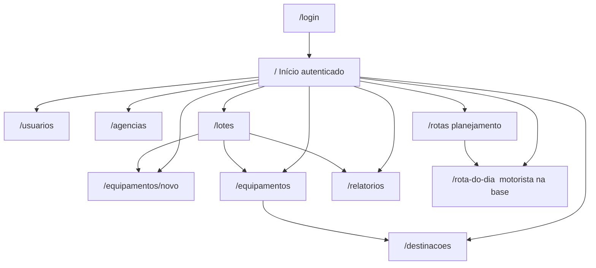
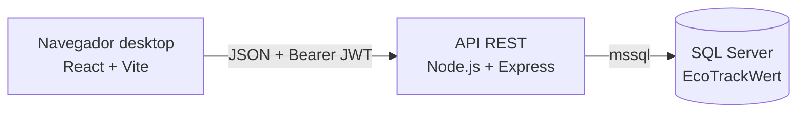
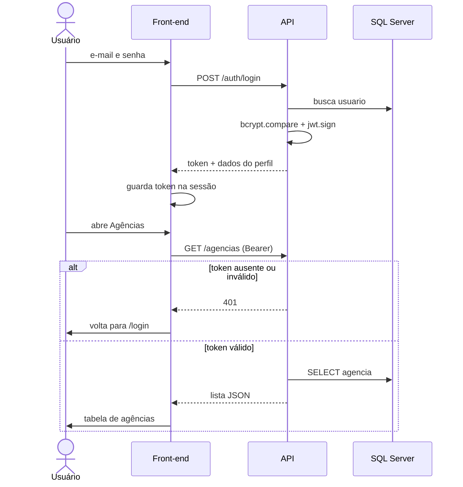
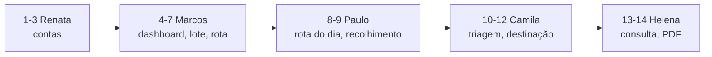

# Artefato 3 — EcoTrack Wert

| Campo | Valor |
| --- | --- |
| Instituição | Centro Universitário de Brasília - CEUB |
| Curso | Ciência da Computação |
| Projeto | EcoTrack Wert |
| Integrantes | Lucas Gonçalves Balduino - 22409139 Artur Feitoza - 22401202 Davi Oliveira Maia - 22305561 Eduardo Martins - 22403813 |
| Documento | Projeto Integrador II - Artefato 3 |
| Professora orientadora | Adriana Falcomer Pontes |
| Local | Brasília |

## 1. Arquitetura da informação

A arquitetura da informação descreve **como o usuário encontra e percorre o EcoTrack**: telas, menu e fluxos por persona. O canal é **web desktop** (navegador). Não há aplicativo nativo nem mapa.

### 1.1 Objetivos que a navegação precisa servir

| Objetivo | O que a informação precisa mostrar |
| --- | --- |
| O1 — Centralizar a operação | Usuários, agências, lotes, equipamentos e destinações no mesmo sistema |
| O2 — Rastreabilidade e conformidade | Caminho agência → lote → equipamento → destinação + PDF e dashboard |
| O3 — Planejamento das coletas | Rota, motorista atribuído e status de recolhimento, sem GPS |

### 1.2 Sitemap

A home autenticada começa como área de trabalho (dashboard na sprint 5). Até lá, é um ponto de entrada para o menu.

### 1.3 Menu e visibilidade por perfil

O menu lateral é o índice permanente. Depois da sprint 6, cada perfil **só vê o que pode operar** (RF04–RF07).

| Item do menu | Rota | Admin | Gestor | Técnico | Auditor | Motorista |
| --- | --- | --- | --- | --- | --- | --- |
| Início / Dashboard | `/` | sim | sim | sim | sim | não |
| Usuários | `/usuarios` | sim | não | não | não | não |
| Agências | `/agencias` | sim | sim | consulta | consulta | não |
| Lotes | `/lotes` | sim | sim | sim | consulta | não |
| Equipamentos | `/equipamentos`, `/equipamentos/novo` | sim | consulta | sim | consulta | não |
| Destinação | `/destinacoes` | sim | consulta | sim | consulta | não |
| Relatórios | `/relatorios` | sim | sim | consulta | sim | não |
| Rotas | `/rotas` | sim | sim | não | consulta | não |
| Rota do dia | `/rota-do-dia` | não | não | não | não | sim |

O auditor consulta e baixa PDF; não cria lote, equipamento nem destinação. O motorista vê só a rota a ele atribuída e registra recolhimento.

Esta é a matriz planejada nesta entrega. As rotas de cada perfil na aplicação, tela a tela, estão na seção 6.

### 1.4 Fluxos por persona

| Persona | Papel | Caminho principal |
| --- | --- | --- |
| **Renata** | Administradora | Login → Usuários (criar/editar/desativar, perfil) |
| **Marcos** | Gestor | Login → Dashboard → Agências / Lotes → Rotas (montar + atribuir motorista) → ver recolhimento |
| **Paulo** | Motorista | Login (na base) → Rota do dia → marcar recolhido / não / parcial |
| **Camila** | Técnica de triagem | Login → Lotes (status em triagem) → cadastrar/listar equipamentos → Destinação → concluir lote |
| **Helena** | Auditora | Login → Lotes / Equipamentos / Destinações (consulta) → Relatórios (gerar e baixar PDF) |

### 1.5 Vocabulário da interface

Os rótulos das telas usam os mesmos termos do backlog, para o usuário não traduzir jargão interno.

| Na tela | Significa |
| --- | --- |
| Agência | Ponto de coleta (código, cidade, UF) |
| Lote | Coleta ligada a uma agência (`pendente`, `em_triagem`, `concluido`) |
| Equipamento | Item do lote (tipo, marca, modelo, série, estado) |
| Destinação | Reciclagem, reúso ou destruição, com empresa e data |
| Rota | Lista ordenada de paradas + data + motorista |
| Recolhimento | `recolhido`, `nao_recolhido` ou `parcial` |

## 2. Design arquitetural

O EcoTrack é uma aplicação **em camadas**: interface web, API REST e banco relacional, empacotados com Docker. A escolha de stack é a do Artefato 1.

### 2.1 Visão em camadas

| Camada | Tecnologia | Responsabilidade |
| --- | --- | --- |
| Front-end | React.js, JavaScript, CSS | Telas desktop, sessão, consumo da API |
| Back-end | Node.js, Express.js | Regras de negócio, autenticação, PDF |
| Persistência | SQL Server | Entidades e histórico (criação/atualização) |
| Ambiente | Docker Compose, Git/GitHub | Subir frontend, API e banco juntos |

Autenticação: senha com **bcrypt**; sessão com **JWT** (RNF02, RNF03). Relatórios em **PDFKit** (RNF08). Sem GPS, sem app nativo (RNF09).

### 2.2 Componentes da API

| Grupo | Rotas (visão) | Sprint em que entra |
| --- | --- | --- |
| Saúde | `GET /health` | esqueleto |
| Autenticação | `POST /auth/login` | 1 |
| Agências | `GET/POST/PUT/DELETE /agencias` | 1 |
| Usuários | CRUD `/usuarios` | 2 |
| Lotes | CRUD `/lotes`; `PATCH .../status` na sprint 3 | 2–3 |
| Equipamentos | `GET/POST /equipamentos`; `PUT` na sprint 9 | 3 e 9 |
| Destinação | CRUD `/destinacoes` | 4 |
| Relatórios | `POST /relatorios/gerar`; `GET /relatorios` | 4–5 |
| Dashboard | `GET /dashboard` | 5 |
| Rotas / recolhimento | CRUD rota, atribuição, status de parada | 7–8 |

Todas as rotas de produto, **exceto** login e health, exigem `Authorization: Bearer`.

### 2.3 Modelo de dados (visão)

O modelo de dados completo, na notação de Peter Chen, com a cardinalidade (mínimo, máximo) de cada relacionamento, o tamanho dos campos e as restrições de cada tabela, está na seção [Dados de `docs/arquitetura.md`](../../docs/arquitetura.md#dados). Ele fica num lugar só e é conferido com o `src/backend/src/config/schema.js` da `main`, para este artefato não manter uma segunda versão do modelo.

Entidades: usuário, agência, lote, equipamento, destinação, relatório, rota e parada.

Perfis no cadastro: administrador, gestor, técnico, auditor e (a partir da sprint 6) motorista. Lote só vai a `concluido` se todo equipamento tiver destinação (RF16).

### 2.4 Sequência — login até uma operação protegida

### 2.5 Implantação local

Docker Compose sobe três serviços: banco, API e front. O front chama a API por URL configurável (`VITE_API_URL`). Isso cobre RNF07 e RNF12 e permite o grupo validar os testes da seção 3 no mesmo ambiente.

## 3. Testes de integração

Os testes abaixo verificam o **encaixe entre tela, API e banco**, não um botão isolado. São casos manuais (pré-condição, passos, resultado). Ainda não há suíte automatizada neste artefato.

Legenda: **P** = passou / **F** = falhou / **N/A** = ainda fora da sprint em execução. A coluna Situação fica em branco na entrega e é preenchida na execução.

### 3.1 Autenticação e sessão

| ID | Caso | RF / RNF | Pré-condição | Passos | Resultado esperado |
| --- | --- | --- | --- | --- | --- |
| TI01 | Login válido | RF01, RNF02 | Seed `admin@wert.com.br` existe | POST `/auth/login` com e-mail e senha corretos | 200, corpo com `token` e `usuario` |
| TI02 | Login inválido | RF01 | — | POST com senha errada | 401, sem token |
| TI03 | Login incompleto | RF01 | — | POST sem senha | 400 |
| TI04 | API sem token | RNF03 | API no ar | GET `/agencias` sem `Authorization` | 401 |
| TI05 | Sessão no browser | RF01 | TI01 ok | Abrir `/login`, entrar, recarregar a página | Permanece autenticado; sem sessão cai em `/login` |

### 3.2 Agências e usuários

| ID | Caso | RF / RNF | Pré-condição | Passos | Resultado esperado |
| --- | --- | --- | --- | --- | --- |
| TI06 | CRUD de agência | RF08 | Usuário autenticado | Criar, listar, editar e excluir agência (API e tela) | Registro persiste; código duplicado é recusado |
| TI07 | CRUD de usuário | RF02, RF03, RF05 | Perfil administrador | Cadastrar usuário com perfil válido; desativar | Lista atualiza; inativo não autentica (403) |

### 3.3 Lote, equipamento e destinação

| ID | Caso | RF / RNF | Pré-condição | Passos | Resultado esperado |
| --- | --- | --- | --- | --- | --- |
| TI08 | Lote ligado à agência | RF09, RF10 | Agência e técnico existem | POST lote; mudar status `pendente` → `em_triagem` | Status gravado |
| TI09 | Cadastrar e listar equipamento | RF11–RF13 | Lote em triagem | POST equipamento; GET do lote | Item aparece na listagem |
| TI10 | Destinação e conclusão | RF15, RF16 | Equipamento no lote | Registrar destinação; tentar `concluido` sem destinação; depois com destinação | Sem destinação a API recusa `concluido`; com destinação aceita |

### 3.4 Conformidade e indicadores

| ID | Caso | RF / RNF | Pré-condição | Passos | Resultado esperado |
| --- | --- | --- | --- | --- | --- |
| TI11 | Gerar PDF | RF18, RNF08 | Lote com destinações | POST gerar relatório | Arquivo PDF armazenado |
| TI12 | Listar e baixar PDF | RF19 | TI11 ok | GET lista; download | Arquivo reabre |
| TI13 | Dashboard | RF17 | Há lotes e destinações | GET `/dashboard` e abrir `/` | Totais e quebras batem com o banco |
| TI14 | PDF com rota e motorista | RF20 | Rota atribuída existe | Gerar PDF do lote da rota | PDF cita motorista e rota |

### 3.5 Logística (sem GPS)

| ID | Caso | RF / RNF | Pré-condição | Passos | Resultado esperado |
| --- | --- | --- | --- | --- | --- |
| TI15 | Montar rota e atribuir | RF21, RF22, RNF09 | Agências e motorista cadastrados | Criar rota com paradas e ordem; atribuir motorista na mão | Rota gravada; **não** há cálculo automático nem mapa |
| TI16 | Rota do dia | RF07, RF23 | TI15 ok; login do motorista | Abrir `/rota-do-dia` | Só a rota daquele usuário |
| TI17 | Status de recolhimento | RF24, RF25 | TI16 ok | Marcar `recolhido`; gestor consulta | Gestor vê a coleta feita no sistema |

### 3.6 Perfil (a partir da sprint 6)

| ID | Caso | RF / RNF | Pré-condição | Passos | Resultado esperado |
| --- | --- | --- | --- | --- | --- |
| TI18 | Auditor não altera operação | RF06, RNF04 | Usuário auditor | Tentar POST de lote ou destinação | API recusa; menu sem ações de cadastro |
| TI19 | Motorista não vê agências | RF07 | Usuário motorista | Abrir o sistema após login | Menu só com rota do dia |

Os casos TI01–TI06 correspondem à sprint 1; os demais entram na sprint em que a feature for desenvolvida. Ambiente: Docker Compose (RNF07).

## 4. Protótipo de baixo nível

Wireframes esquemáticos (caixas e rótulos), sem cor final nem pixels. O visual de entrega copia o CSS da Wert (fundo claro, acento verde, sidebar + header), descrito no design system do projeto. Convenção: `[ botão ]` · `( campo )` · `===` região.

### 4.1 Login — `/login`

Campos obrigatórios. Sucesso grava a sessão e vai para `/`. Erro: mensagem acima do botão.

### 4.2 Casca autenticada (sidebar + header)

Itens do menu seguem a tabela da seção 1.3. O motorista não vê esta casca completa: só a rota do dia.

### 4.3 Agências — `/agencias`

Agências: cadastre os pontos de coleta.

### 4.4 Lotes — `/lotes`

Status visível; conclusão bloqueada se faltar destinação (mensagem de erro, não só o botão sumir).

### 4.5 Equipamentos — cadastro e lista

Poucos campos obrigatórios além dos já definidos (RNF10). Série pode ser vazia.

### 4.6 Destinação

Uma destinação por equipamento.

### 4.7 Dashboard — `/`

### 4.8 Planejamento de rota (Marcos) e rota do dia (Paulo)

Atribuição **manual**. O motorista não monta rota; só consulta e marca status.

### 4.9 Relatórios

## 5. Storyboard

Storyboard no formato tradicional: quadros em sequência, cada um com a **cena** (onde e quando), a **ação do usuário** e a **resposta do sistema**. Os quadros seguem os fluxos principais de cada perfil, na ordem da jornada da Lean Inception: a administradora prepara as contas, o gestor planeja, o motorista executa a coleta, a técnica faz a triagem e a auditora fecha a evidência. As telas são as da aplicação atual; o esboço de cada quadro é o wireframe da seção 4.

### Administrador — Renata

#### Quadro 1 — Entrar no sistema

| | |
| --- | --- |
| Cena | Escritório da Wert, início da operação. Renata abre o EcoTrack no navegador. |
| Ação do usuário | Informa e-mail e senha em `/login` e clica em **Entrar**. |
| Resposta do sistema | Abre o **Dashboard** (`/`) com o menu completo do administrador. Com e-mail ou senha errados, mostra a mensagem de erro e continua no login. |

#### Quadro 2 — Criar as contas da equipe

| | |
| --- | --- |
| Cena | Renata recebe a lista de quem vai operar o sistema. |
| Ação do usuário | Em **Usuários** (`/usuarios`), preenche nome, e-mail, senha e perfil (gestor, técnico, auditor ou motorista) e clica em **Criar**. |
| Resposta do sistema | O usuário aparece na lista com o perfil escolhido. Cada pessoa passa a ter o próprio login. |

#### Quadro 3 — Desativar quem saiu

| | |
| --- | --- |
| Cena | Um colaborador deixa a Wert. |
| Ação do usuário | Na lista de **Usuários**, clica em **Desativar** na linha dele. |
| Resposta do sistema | O status muda para inativo e a pessoa não consegue mais entrar. **Ativar** desfaz. |

### Gestor — Marcos

#### Quadro 4 — Ver a semana

| | |
| --- | --- |
| Cena | Segunda-feira de manhã, no escritório. |
| Ação do usuário | Entra no sistema e fica no **Dashboard** (`/`). |
| Resposta do sistema | Mostra os totais de equipamentos, lotes, agências e destinações e as quebras por status do lote, tipo e estado do equipamento e destino final. |

#### Quadro 5 — Registrar o ponto de coleta e o lote

| | |
| --- | --- |
| Cena | Uma agência pede o recolhimento de equipamentos. |
| Ação do usuário | Em **Agências** (`/agencias`), cadastra a agência (nome, código, cidade, UF, responsável). Em **Lotes** (`/lotes`), abre um lote para ela, com data de coleta e técnico. |
| Resposta do sistema | A agência entra na lista. O lote aparece com status `pendente`, ligado à agência. |

#### Quadro 6 — Montar a rota e atribuir o motorista

| | |
| --- | --- |
| Cena | Véspera da coleta. Marcos organiza as paradas do dia. |
| Ação do usuário | Em **Rotas** (`/rotas`), escolhe a data e o motorista, adiciona as paradas (agência e, se houver, o lote) na ordem da visita e clica em salvar. |
| Resposta do sistema | A rota entra na lista com data, motorista, paradas em ordem e a coluna **Recolhimento** com todas as paradas pendentes. |

#### Quadro 7 — Acompanhar o recolhimento

| | |
| --- | --- |
| Cena | Fim do dia, depois que o motorista volta. |
| Ação do usuário | Abre de novo **Rotas** (`/rotas`). |
| Resposta do sistema | A coluna **Recolhimento** mostra, por rota, quantas paradas foram recolhidas, parciais, não recolhidas e pendentes. Rota com parada já marcada não pode mais ser editada, excluída nem trocar de motorista. |

### Motorista — Paulo

#### Quadro 8 — Consultar a rota do dia

| | |
| --- | --- |
| Cena | Computador da base, antes de sair com o caminhão. |
| Ação do usuário | Entra no sistema e abre **Rota do dia** (`/rota-do-dia`), que já vem com a data de hoje. |
| Resposta do sistema | Mostra só as rotas atribuídas a ele naquela data, com as paradas na ordem da visita (agência e lote). Sem rota atribuída, avisa que não há rota para ele nesta data. |

#### Quadro 9 — Marcar o recolhimento

| | |
| --- | --- |
| Cena | De volta à base, com a coleta feita. |
| Ação do usuário | Em cada parada, clica em **Recolhido**, **Parcial** ou **Não recolhido**. |
| Resposta do sistema | Grava o status da parada com a hora da marcação. O gestor passa a ver o resultado na tela de Rotas. |

### Técnico de triagem — Camila

#### Quadro 10 — Começar a triagem do lote

| | |
| --- | --- |
| Cena | Galpão. O caminhão chegou com o lote da agência. |
| Ação do usuário | Em **Lotes** (`/lotes`), localiza o lote e clica em **Em triagem**. |
| Resposta do sistema | O status do lote muda para `em_triagem`. |

#### Quadro 11 — Lançar e conferir os equipamentos

| | |
| --- | --- |
| Cena | Bancada de triagem, com os equipamentos do lote. |
| Ação do usuário | Em **Equipamentos** (`/equipamentos/novo`), escolhe o lote e informa tipo, marca, modelo, número de série e estado. Em **Listagem** (`/equipamentos`), confere o lote e corrige um item com **Editar**. |
| Resposta do sistema | O equipamento entra na lista do lote. Número de série repetido é recusado com mensagem. |

#### Quadro 12 — Registrar a destinação e concluir o lote

| | |
| --- | --- |
| Cena | Fim da triagem. Cada equipamento já tem destino definido. |
| Ação do usuário | Em **Destinação** (`/destinacoes`), registra para cada equipamento o tipo de destino (reciclagem, reúso ou destruição), a empresa, a data e, se houver, o link do certificado. Depois, em **Lotes**, clica em **Concluir**. |
| Resposta do sistema | O lote só passa a `concluido` quando todos os equipamentos têm destinação. Se faltar algum, mostra a mensagem de erro e o lote continua em triagem. |

### Auditor — Helena

#### Quadro 13 — Seguir o caminho do ativo

| | |
| --- | --- |
| Cena | Auditoria de conformidade de um lote concluído. |
| Ação do usuário | Consulta **Lotes**, **Listagem** e **Destinação** para seguir agência → lote → equipamentos → destinação. |
| Resposta do sistema | Mostra os dados para consulta. Qualquer tentativa de gravar é recusada pela API: o auditor não altera a operação. |

#### Quadro 14 — Gerar e baixar a evidência

| | |
| --- | --- |
| Cena | Fechamento da auditoria. |
| Ação do usuário | Em **Relatórios** (`/relatorios`), escolhe o lote, clica em **Gerar PDF** e depois em **Baixar PDF** na lista. |
| Resposta do sistema | Gera o relatório de conformidade do lote com agência, equipamentos e destinações e, quando existe, a rota de coleta com data e motorista. O relatório fica na lista para ser baixado de novo. |

## 6. Rotas de usabilidade por perfil

As rotas abaixo são as da aplicação: o menu lateral mostra a cada perfil só as telas que ele pode abrir, e a API recusa (403) a operação que o perfil não pode fazer.

Regras comuns a todos os perfis:

- `/login` é a única tela aberta sem sessão. Quem já entrou e abre `/login` volta para `/`.
- Depois do login, todos os perfis caem no **Dashboard** (`/`).
- Endereço que não existe leva para `/` (com sessão) ou para `/login` (sem sessão).
- Tela fora do perfil, digitada na barra de endereço, leva de volta para `/`.
- O cabeçalho de todas as telas tem **A−** e **A+** (tamanho da fonte), alto contraste, tema claro ou escuro e **Sair**.

### 6.1 Administrador

| Tela | Caminho | Ações permitidas |
| --- | --- | --- |
| Dashboard | `/` | Ver totais e quebras |
| Agências | `/agencias` | Cadastrar, editar e excluir agência |
| Usuários | `/usuarios` | Criar, editar, ativar e desativar usuário; escolher o perfil |
| Lotes | `/lotes` | Abrir e editar lote; mudar o status para pendente, em triagem ou concluído |
| Equipamentos | `/equipamentos/novo` | Cadastrar equipamento num lote |
| Listagem | `/equipamentos` | Consultar e editar equipamento |
| Destinação | `/destinacoes` | Registrar, editar e excluir destinação |
| Relatórios | `/relatorios` | Gerar o PDF do lote e baixar os relatórios gerados |
| Rotas | `/rotas` | Criar, editar e excluir rota; atribuir o motorista; ver o recolhimento |

### 6.2 Gestor

| Tela | Caminho | Ações permitidas |
| --- | --- | --- |
| Dashboard | `/` | Ver totais e quebras |
| Agências | `/agencias` | Cadastrar, editar e excluir agência |
| Lotes | `/lotes` | Abrir e editar lote; mudar o status |
| Equipamentos | `/equipamentos/novo` | Cadastrar equipamento num lote |
| Listagem | `/equipamentos` | Consultar e editar equipamento |
| Destinação | `/destinacoes` | Registrar, editar e excluir destinação |
| Relatórios | `/relatorios` | Gerar o PDF do lote e baixar os relatórios gerados |
| Rotas | `/rotas` | Criar, editar e excluir rota; atribuir o motorista; ver o recolhimento |

O gestor não abre **Usuários**.

### 6.3 Técnico

| Tela | Caminho | Ações permitidas |
| --- | --- | --- |
| Dashboard | `/` | Ver totais e quebras |
| Lotes | `/lotes` | Abrir e editar lote; mudar o status |
| Equipamentos | `/equipamentos/novo` | Cadastrar equipamento num lote |
| Listagem | `/equipamentos` | Consultar e editar equipamento |
| Destinação | `/destinacoes` | Registrar, editar e excluir destinação |

O técnico não abre **Agências**, **Usuários**, **Relatórios** nem **Rotas**.

### 6.4 Auditor

| Tela | Caminho | Ações permitidas |
| --- | --- | --- |
| Dashboard | `/` | Ver totais e quebras |
| Lotes | `/lotes` | Consultar |
| Listagem | `/equipamentos` | Consultar |
| Destinação | `/destinacoes` | Consultar |
| Relatórios | `/relatorios` | Gerar o PDF do lote e baixar os relatórios gerados |

O auditor não abre **Agências**, **Usuários**, **Equipamentos** (cadastro) nem **Rotas**. Nas telas de Lotes e Destinação o formulário ainda aparece para ele, mas a API recusa a gravação.

### 6.5 Motorista

| Tela | Caminho | Ações permitidas |
| --- | --- | --- |
| Dashboard | `/` | Ver totais e quebras |
| Rota do dia | `/rota-do-dia` | Escolher a data; ver as próprias rotas e paradas; marcar cada parada como recolhida, parcial ou não recolhida |

O motorista só vê as rotas atribuídas a ele e só marca o recolhimento das paradas delas.
