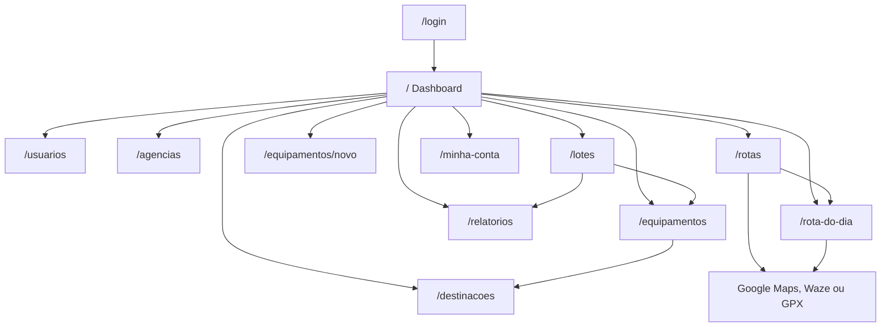
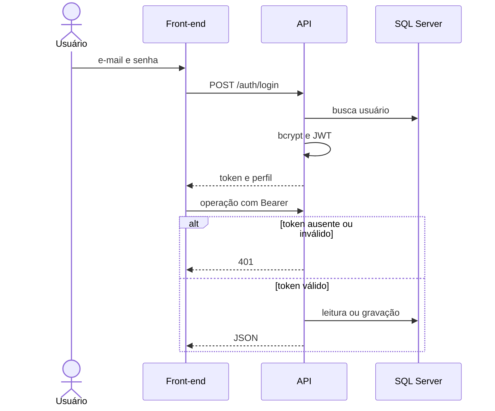
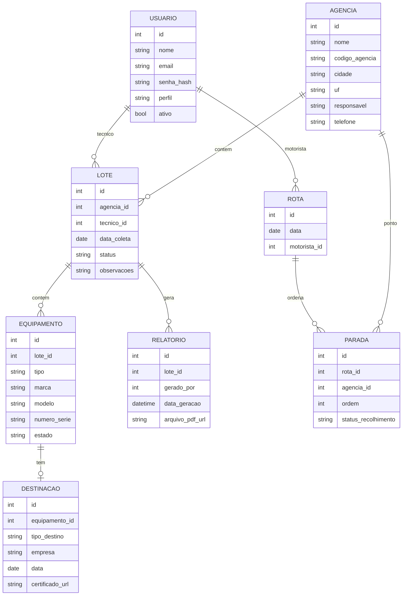

# Arquitetura

## Contexto técnico

Produto web para a operação da Wert. Uso em navegador, na base da empresa, em desktop ou tablet. Desenvolvimento local com containers e, a partir da Sprint 10, sistema publicado com HTTPS. Sem aplicativo de campo e sem rastreamento do veículo em tempo real: a rota usa a localização cadastrada dos pontos de coleta e de entrega, e a navegação até as paradas abre no Google Maps, no Waze ou em arquivo GPX.

A navegação, as camadas e o modelo de dados abaixo são as características gerais do produto. O [Artefato 3](../entregas/artefato_3/README.md) continua sendo a entrega acadêmica (testes de integração, wireframes e storyboard). Este arquivo deixa o mesmo desenho legível no repositório.

## Objetivos da informação

| Objetivo | O que o sistema precisa mostrar |
| --- | --- |
| Centralizar a operação | Usuários, agências, lotes, equipamentos e destinações no mesmo lugar |
| Rastreabilidade e conformidade | Caminho agência, lote, equipamento e destinação, com PDF e dashboard |
| Planejamento das coletas | Rota com origem, destino e paradas localizadas, motorista atribuído, status de recolhimento e exportação para navegação |

## Componentes

O código da aplicação fica em `src/`:

```text
src/
├── backend/     API REST, regras de negócio, geração de PDF
└── frontend/    Interface web
```

| Camada | Tecnologia | Responsabilidade |
| --- | --- | --- |
| Front-end | React, JavaScript, CSS | Telas desktop, sessão e consumo da API |
| Back-end | Node.js, Express | Regras de negócio, autenticação, autorização e PDF |
| Persistência | SQL Server | Entidades e datas de criação e atualização |
| Ambiente | Docker Compose | Banco, API e interface sobem juntos |
| Publicação | Docker Compose de produção, Caddy | HTTPS, segredos fora do repositório, banco e PDFs em volumes |

Fluxo geral: usuário, interface web, API, banco de dados. O front chama a API pela URL configurável `VITE_API_URL`. No sistema publicado, a interface e a API ficam no mesmo endereço, e a API responde em `/api`.

```text
[Navegador desktop]
        |
        v
[src/frontend] --JSON + Bearer JWT--> [src/backend] --SQL--> [SQL Server]
                                            |
                                            v
                                       [PDFs gravados]
```

## Navegação

Canal: navegador, em desktop ou tablet. Não há aplicativo nativo. A rota tem a localização dos pontos e é aberta nos aplicativos de navegação (Google Maps, Waze ou GPX); não há rastreamento do veículo em tempo real.



O menu lateral é o índice permanente. Cada perfil vê só as telas que pode abrir, e a API recusa a operação que o perfil não pode fazer. Tela fora do perfil, digitada na barra de endereço, volta para o Dashboard.

| Item | Rota | Admin | Gestor | Técnico | Auditor | Motorista |
| --- | --- | --- | --- | --- | --- | --- |
| Dashboard | `/` | sim | sim | sim | sim | sim |
| Agências | `/agencias` | sim | sim | não | não | não |
| Usuários | `/usuarios` | sim | não | não | não | não |
| Lotes | `/lotes` | sim | sim | sim | consulta | não |
| Equipamentos | `/equipamentos/novo` | sim | sim | sim | não | não |
| Listagem | `/equipamentos` | sim | sim | sim | consulta | não |
| Destinação | `/destinacoes` | sim | sim | sim | consulta | não |
| Relatórios | `/relatorios` | sim | sim | não | sim | não |
| Rotas | `/rotas` | sim | sim | não | não | não |
| Rota do dia | `/rota-do-dia` | não | não | não | não | sim |
| Minha conta | `/minha-conta` | sim | sim | sim | sim | sim |

Mudanças de navegação da Sprint 10:

- **Minha conta** (`/minha-conta`), para todos os perfis: troca da própria senha (RF26).
- **Rotas** e **Rota do dia**: origem, destino, ordem sugerida das paradas e mapa da rota com Leaflet e OpenStreetMap (RF29) e exportação para Google Maps, Waze e GPX (RF30, RF31).
- Cadastro dos pontos de entrega e da localização das agências, para administrador e gestor (RF27, RF28).
- O motorista entra direto na Rota do dia depois do login (RNF17).

O auditor consulta lotes, equipamentos e destinações e gera e baixa relatórios. Não cria lote, equipamento nem destinação. O motorista vê a rota atribuída a ele, registra o recolhimento e abre a navegação até as paradas.

| Persona | Papel | Caminho principal |
| --- | --- | --- |
| Renata | Administradora | Login, usuários, perfis |
| Marcos | Gestor | Dashboard, agências, lotes, rotas e recolhimento |
| Camila | Técnica de triagem | Lotes, equipamentos, destinação, conclusão do lote |
| Helena | Auditora | Consulta operacional e relatórios |
| Paulo | Motorista | Rota do dia, navegação até as paradas e status de recolhimento |

| Na tela | Significa |
| --- | --- |
| Agência | Ponto de coleta: código, cidade, UF, endereço e coordenadas |
| Ponto de entrega | Depósito ou destinadora: endereço e coordenadas |
| Lote | Coleta ligada a uma agência: `pendente`, `em_triagem` ou `concluido` |
| Equipamento | Item do lote: tipo, marca, modelo, série e estado |
| Destinação | Reciclagem, reúso ou destruição, com empresa, data e certificado opcional |
| Rota | Data, motorista, origem, destino e paradas ordenadas |
| Recolhimento | `recolhido`, `nao_recolhido` ou `parcial` |

## API

Todas as rotas de produto, exceto `POST /auth/login` e `GET /health`, exigem `Authorization: Bearer`.

| Grupo | Rotas |
| --- | --- |
| Saúde | `GET /health` |
| Autenticação | `POST /auth/login` e `PUT /auth/senha` (troca da própria senha) |
| Agências | `GET`, `POST`, `PUT` e `DELETE /agencias` |
| Usuários | CRUD `/usuarios` |
| Lotes | CRUD `/lotes` e `PATCH /lotes/:id/status` |
| Equipamentos | `GET`, `POST` e `PUT /equipamentos` |
| Destinação | CRUD `/destinacoes` |
| Relatórios | `POST /relatorios/gerar`, `GET /relatorios` e `GET /relatorios/:id/arquivo` (download do PDF) |
| Dashboard | `GET /dashboard` |
| Rotas e recolhimento | Cadastro da rota, atribuição do motorista e status da parada |

Senha com bcrypt. Sessão com JWT. PDF com PDFKit. A partir da Sprint 10, o PDF é baixado só por `GET /relatorios/:id/arquivo`, com login e perfil administrador, gestor ou auditor, e a pasta de arquivos não é pública. A chave do token, a senha do banco, a senha inicial do administrador e a origem permitida da API vêm de variáveis de ambiente. O login tem limite de tentativas, e as respostas de erro não trazem detalhe interno.



## Dados

Modelo do produto, com os atributos de cada entidade. Rota e parada fazem parte dessa modelagem, junto com a operação e a conformidade.



| Entidade | Papel | Atributos |
| --- | --- | --- |
| Usuário | Acesso e responsabilidade | id, nome, e-mail, senha_hash, perfil, ativo |
| Agência | Ponto de coleta | id, nome, codigo_agencia, cidade, uf, responsavel, telefone |
| Lote | Coleta da agência | id, agencia_id, tecnico_id, data_coleta, status, observacoes |
| Equipamento | Item do lote | id, lote_id, tipo, marca, modelo, numero_serie, estado |
| Destinação | Fechamento do item | id, equipamento_id, tipo_destino, empresa, data, certificado_url. Uma por equipamento |
| Relatório | Evidência do lote | id, lote_id, gerado_por, data_geracao, arquivo_pdf_url |
| Rota | Planejamento da coleta | id, data, motorista_id |
| Parada | Ponto da rota | id, rota_id, agencia_id, ordem, status_recolhimento |

Relacionamentos:

- uma agência possui vários lotes
- um lote contém vários equipamentos e pode gerar vários relatórios
- um equipamento possui um registro de destinação
- uma rota tem paradas ordenadas e um motorista
- o lote só vai a `concluido` quando todo equipamento tiver destinação

Perfis de cadastro: administrador, gestor, técnico, auditor e motorista.

Senhas não são armazenadas em texto. Não versionar `.env`, credenciais ou dados reais de operação.

## Decisões técnicas

- Front-end: React, JavaScript, CSS, consumo REST
- Back-end: Node.js, Express, JWT, bcrypt, PDFKit
- Banco: SQL Server
- Ambiente: Docker Compose, Git/GitHub

Racional registrado em [ADR 001](decisoes/adr-001-stack-e-estrutura.md).

## Riscos

| Risco | Impacto | Mitigação |
| --- | --- | --- |
| SQL Server e Docker pesados no ambiente local | Atraso de validação | Health check e Compose versionado com o código |
| Autorização por perfil tarde no calendário | Cadastros abertos demais no meio do semestre | Núcleo rastreável primeiro; restrição por perfil na sprint correspondente |
| Código fora de `src/` | Divergência com o combinado da turma | PRs de produto só alteram `src/backend` ou `src/frontend` |
